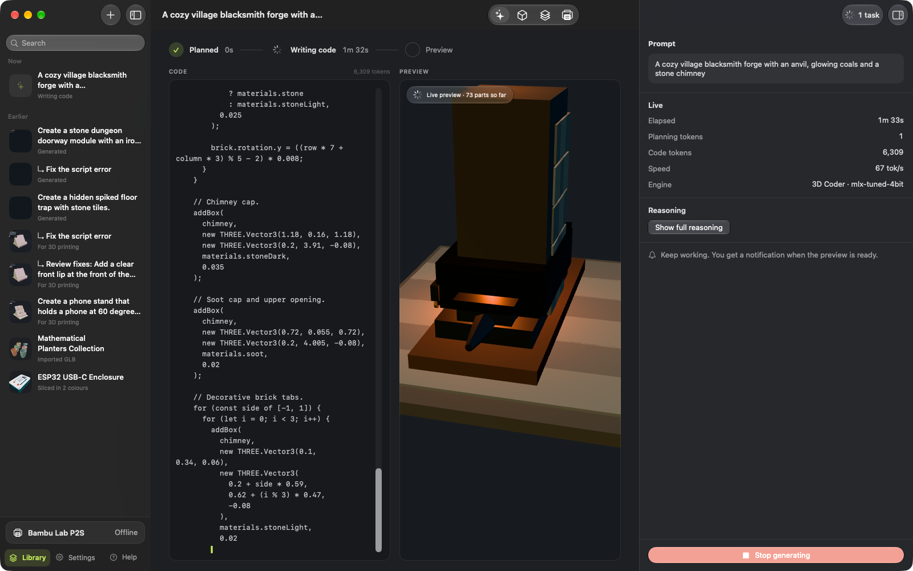
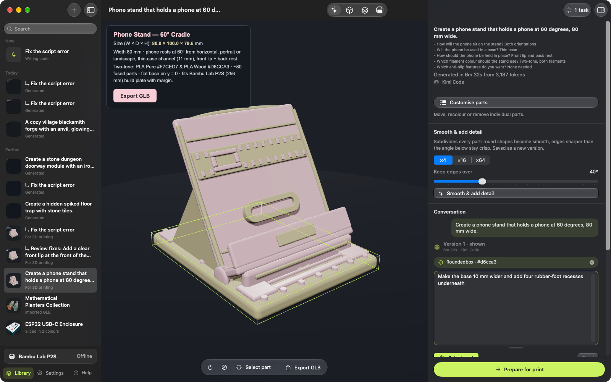
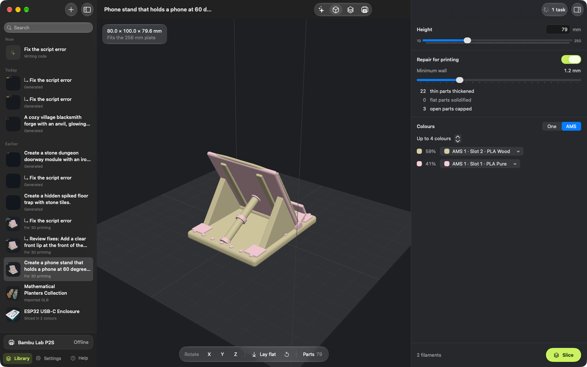
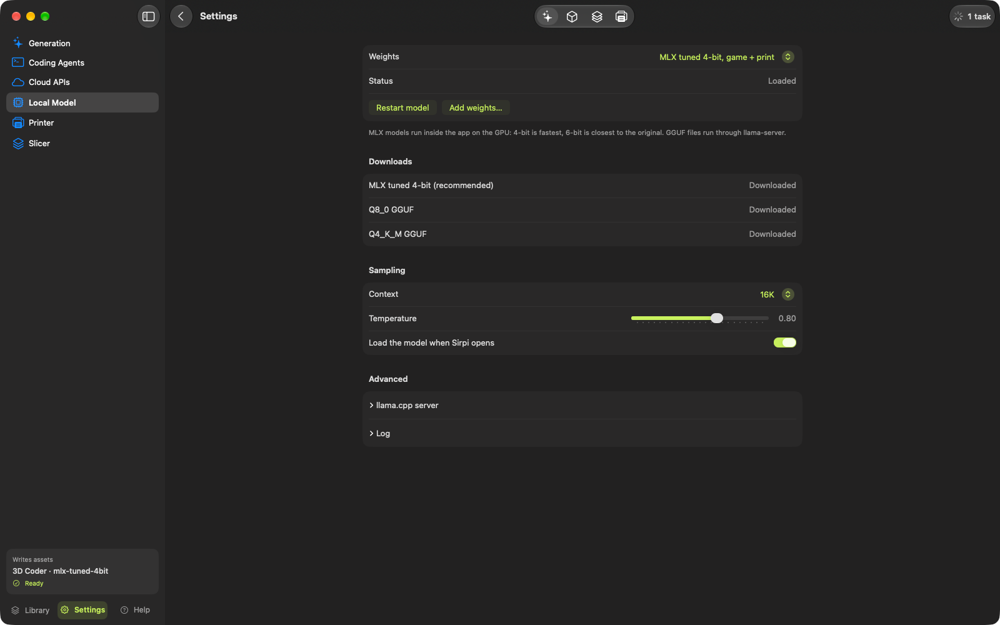

<p align="center">
  
</p>

<h1 align="center">Sirpi (சிற்பி)</h1>

<p align="center"><b>Describe it, and Sirpi sculpts it in 3D.</b><br>
A native macOS app that turns a sentence or a picture into a game asset, a 3D print or a whole editable scene.<br>
Runs a fine-tuned model on your Mac's GPU, or the coding agents and AI services you already use.</p>

<p align="center">
  <a href="https://github.com/chandrasekar-r/sirpi/releases/latest">Download</a> ·
  <a href="#build-from-source">Build</a> ·
  <a href="finetune/README.md">Fine-tuning toolkit</a>
</p>

*Sirpi* means "sculptor" in Tamil.


## What it does

### Make

- **Three purposes.** *Game asset* (a GLB for Godot or any engine), *3D print* (one solid, watertight object at real size in millimetres, sized to fit your printer), or *3D scene* (a whole place such as a street or a room, in metres, with every object separately named).
- **Text or picture in.** Describe what you want, or attach a reference picture. Before generating, Sirpi asks a few follow-up questions (style, size, colours, purpose) so the result matches what you had in mind.
- **Live preview.** While the code is being written, Sirpi runs the part that is finished every couple of seconds and shows the model taking shape next to the code.
- **Reviewed automatically.** Every new asset is checked against your request; after an asset made from a picture, Sirpi renders it from four sides next to the picture, asks a vision model what differs, and refines it once.
- **Real-world assets.** Browse and import the 2,677 [NVIDIA SimReady](https://huggingface.co/datasets/nvidia/simready-assets) assets (OpenUSD with PBR materials), converted to GLB on demand.

### Change

- **Point at what to change.** Turn on *Select part*, click a part of the model, and say what should change. The request names that part, its shape, colour and position, and the code that builds it, so the rest stays as it is.
- **One conversation per asset.** Every request, error fix and version of an asset stays in one conversation. Click a version to show it; the original is never overwritten.
- **Fast fixes.** With models that can, fixes and refinements come back as small edits to the existing code, so fixing a script error takes seconds. The local model rewrites the whole file instead, and Sirpi puts back any helper function the rewrite leaves out. Script errors point at the failing line of the asset, even when the error is thrown inside three.js. A generation that was stopped or cut off can be continued from where it ended.
- **Customise by hand.** Select objects in a scene, move, rotate and scale them with a gizmo, recolour materials, duplicate, delete, and insert assets from your library. Every change is a new version.
- **Detail on demand.** *Smooth & add detail* subdivides meshes so curves become smooth while sharp edges stay crisp.

### Print (Bambu Lab)

- **Prepare.** Repairs meshes into watertight solids, shrinks prints that would not fit, and matches colours to the filament in your AMS.
- **Slices with what is loaded.** Sirpi reads each AMS slot's spool and slices with its own Bambu preset and temperature range in Bambu Studio, and warns when the loaded filament differs from what a file was sliced for.
- **Print check.** Before and after slicing, Sirpi measures the model and the G-code and explains what may go wrong: parts that start in mid-air, rough overhangs, long bridges, warping and detaching, thin parts that may collapse, under-extrusion, stringing, gloss differences, layer cracking and banding. Each finding has one-click fixes to the slice or the model, and an AI review of the slice is a click away.
- **Supports only when needed.** Supports turn on only when the model has islands or steep overhangs, and your choice is remembered.
- **STL repair.** Imported and exported meshes are checked and repaired (holes, flipped and duplicate faces) before slicing, with no online repair tool.
- **Send and watch.** Sends the job over the local network (LAN mode), finds printers even while Bambu Studio is open, and shows the printer's camera live (RTSPS for P2S, X1 and H2; JPEG for P1 and A1).

### Export

- GLB (optionally with lightmap UVs for Godot's LightmapGI), OBJ with colours, a copy straight into a Godot project, Blender (open, or save a `.blend`), STL and sliced 3MF.
- **Turntable videos.** A seamless 360° video of any asset: 720p to 4K, square or vertical, studio, soft or dramatic lighting, and a transparent background (HEVC with alpha) for trailers and editors.

### Models

- **Local first.** [Sirpi's fine-tune of the 3D Coder](https://huggingface.co/Chandrasekar/Qwen3.5-4B-GLB-3D-Coder-Sirpi-MLX-4bit), based on [ccore's Qwen3.5-4B GLB 3D Coder](https://huggingface.co/ccore/Qwen3.5-4B-GLB-3D-Coder), downloads on first launch (2.4 GB) and runs inside the app on the GPU with [MLX](https://github.com/ml-explore/mlx-swift): no server, nothing leaves your Mac. Compared with the original it makes working print models far more often (16 of 20 test prompts against 11), gets sizes right four times as often, and writes half as much code, so assets finish in about half the time.
- **Or bring your own.** Coding-agent CLIs you are already signed in to (Claude Code, opencode, Grok CLI, Kimi Code, Cursor Agent, Codex, Gemini CLI, pi) are detected automatically and use their own logins; their answers stream live. Cloud APIs (Claude, OpenAI, Gemini, xAI, Cloudflare Workers AI, OpenRouter, Groq, DeepSeek, Mistral) and local servers (Ollama, LM Studio) work with a key or URL.

| Follow-up questions before it starts | The preview builds live while the model writes |
|---|---|
|  |  |
| **Select a part and say what to change** | **Prepare: repair, size and AMS colours** |
|  |  |

## Install

1. Download `Sirpi-<version>-macOS-arm64.zip` from [Releases](https://github.com/chandrasekar-r/sirpi/releases/latest), unzip, and move `Sirpi.app` to Applications.
2. The app is not notarised. The first time, right-click it and choose **Open**, or run:
   ```sh
   xattr -dr com.apple.quarantine /Applications/Sirpi.app
   ```

Requirements: an Apple silicon Mac and macOS 27 or later. 16 GB of memory is enough for the local model; more is better.

### Get a model

Pick one or more:

- **Local 3D Coder (free, private).** Downloaded automatically on first launch (2.4 GB), or from **Settings › Local Model › Downloads**. To use ccore's original model instead, the same section downloads its GGUF files, or convert it to MLX with [uv](https://docs.astral.sh/uv/) (about 4 GB to download and 20 GB free while converting):
  ```sh
  tools/model/setup_local_model.sh          # MLX 4-bit, the fastest
  tools/model/setup_local_model.sh --6bit   # also MLX 6-bit, closest to the original
  ```
  Then choose it in **Settings › Local Model**.

  
- **A coding agent you already use.** Install and sign in to it once in Terminal; Sirpi finds it in **Settings › Coding Agents**.
- **A cloud API.** Add a key in **Settings › Cloud APIs**. Keys are stored in a file only your user account can read.

### Optional

- [Bambu Studio](https://bambulab.com/en/download/studio) for slicing, and a Bambu Lab printer in LAN mode for printing.
- [Blender](https://www.blender.org/download/) for Blender export.
- [uv](https://docs.astral.sh/uv/) for importing NVIDIA SimReady assets (Sirpi sets up Pixar's USD converter on first use).

## Build from source

Needs Xcode 27 (for MLX's Metal shaders) and its Metal toolchain:

```sh
xcodebuild -downloadComponent MetalToolchain   # once
./scripts/build.sh                             # builds build/Sirpi.app
./scripts/build.sh --install                   # and copies it to /Applications
```

## How it works

| Part | Implementation |
|---|---|
| App | SwiftUI on macOS 27 with Liquid Glass. Pages are rendered with WebKit (`WebPage`) through a `forge://` URL scheme. |
| Local model | `NativeEngine` runs MLX in-process (`mlx-swift-lm`), streaming tokens off the main thread. GGUF files can also run through `llama-server`. |
| Providers | `Providers.swift` (OpenAI-compatible, Claude Messages API, and CLI agents run headless in an empty folder; Kimi Code runs through its Agent Client Protocol server in `KimiACP.swift` so it streams). `CLIDiscovery.swift` finds agents and checks sign-in with each CLI's own status command. |
| Generation | The model writes one standalone Three.js page with an *Export GLB* button. `Resources/web/bridge.js` captures script errors and the exported GLB. |
| Mesh tools | `Resources/web/` (three.js r187): crease-aware Loop subdivision, lightmap UVs, OBJ export, the scene editor, and print preparation with [Manifold](https://github.com/elalish/manifold). |
| Printing | Bambu Studio CLI for slicing; MQTT over TLS and FTPS to the printer in LAN mode. |
| Print check | `PrintCheck.swift` reads binary STLs (contact area, overhang angles, islands found by ray casting) and the sliced G-code (bridges, overhang walls, flow against the material's melt limit, travel moves), then turns them into findings with fixes. `MeshRepair.swift` welds, re-orients and closes meshes. |
| Part picking and live preview | `Resources/web/three-hook.js` wraps three.js so Sirpi can see a page's scenes; `pick.js` raycasts clicks and reports the part. `live.html` runs the longest valid prefix of a half-written script (closing open brackets) and frames what it has built. |
| SimReady | `Resources/tools/simready_to_glb.py` uses Pixar's `usd-core` to flatten instanced USD meshes and map NVIDIA's OmniPBR materials to glTF PBR. |
| Fine-tuning | [`finetune/`](finetune/README.md): rejection-sampling LoRA on Apple silicon, including a chunked Gated DeltaNet kernel that makes long-sequence training of Qwen3.5 possible in mlx-lm. |

## Privacy

With the local model, generation never leaves your Mac. Coding agents and cloud APIs receive your prompt (and reference picture, if attached) under their own terms. API keys are stored in `~/Library/Application Support/Sirpi/` with permissions for your user only. Sirpi never reads or copies coding-agent credentials.

## Credits

- 3D Coder model by [ccore](https://huggingface.co/ccore/Qwen3.5-4B-GLB-3D-Coder), based on [Qwen3.5-4B](https://huggingface.co/Qwen/Qwen3.5-4B) (Apache-2.0). Sirpi's fine-tune is published at [Chandrasekar/Qwen3.5-4B-GLB-3D-Coder-Sirpi-MLX-4bit](https://huggingface.co/Chandrasekar/Qwen3.5-4B-GLB-3D-Coder-Sirpi-MLX-4bit) under the same licence.
- [three.js](https://threejs.org), [Manifold](https://github.com/elalish/manifold), [MLX](https://github.com/ml-explore), [swift-transformers](https://github.com/huggingface/swift-transformers).
- [NVIDIA SimReady](https://huggingface.co/datasets/nvidia/simready-assets) assets (CC-BY-4.0).

See [THIRD_PARTY_NOTICES.md](THIRD_PARTY_NOTICES.md).

## Licence

[MIT](LICENSE) © 2026 Chandrasekar R
